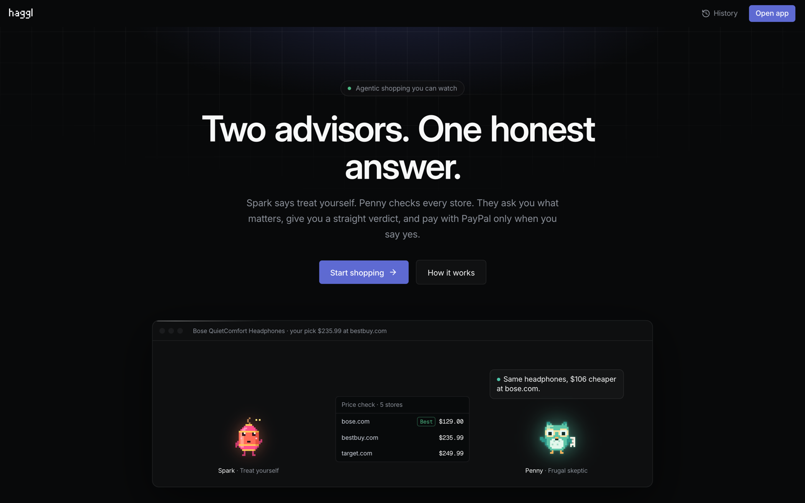
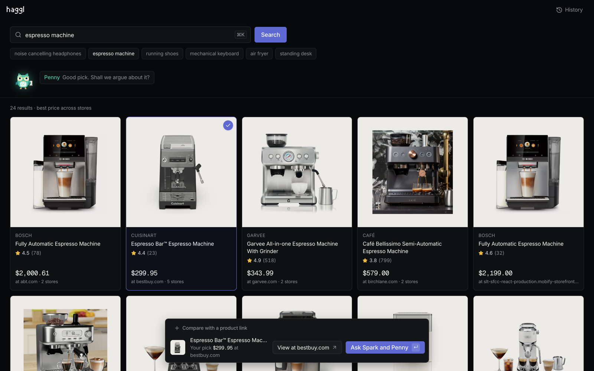
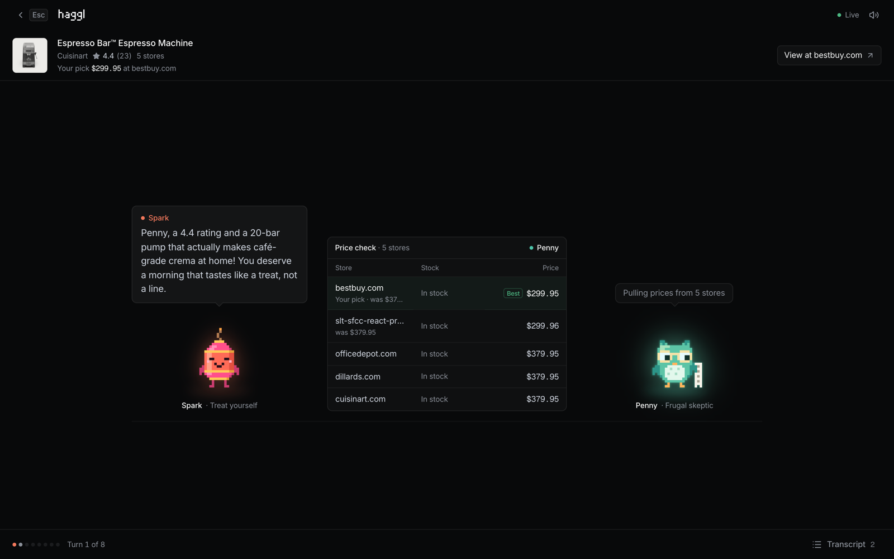
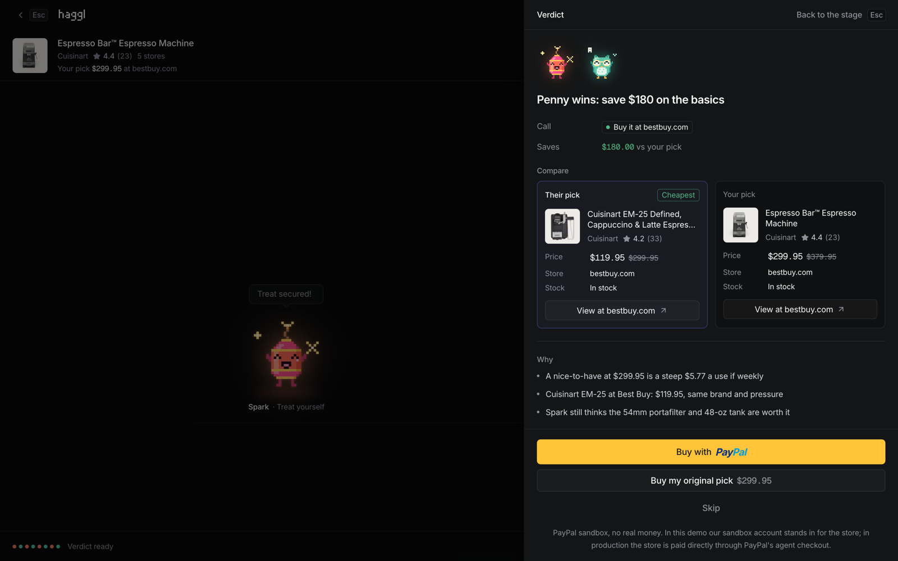

# Haggl

**Two AI advisors argue about your purchase, so you don't overspend.**

Spark says treat yourself. Penny checks every store. They ask you what matters, give you a straight verdict, and pay with PayPal only when you say yes.

**[Live demo](https://haggl-664a.onrender.com)** · Built for the PayPal AI Hackathon (2026) · MIT license



## What it does

1. **Search or paste a link.** Real products and prices from many stores (Channel3), or any product page link.
2. **Watch the debate.** Spark (treat yourself) and Penny (frugal skeptic), two pixel-art AI agents, argue it out. Penny checks the same item at other stores and finds cheaper alternatives; Spark makes the case for buying.
3. **Answer two questions.** They stop and ask what matters, like your budget or how often you'd use it, and your answers change the argument.
4. **Get a verdict.** Buy, buy it cheaper elsewhere, wait, or skip, with a side-by-side comparison.
5. **Decide.** On **Buy**, the agent creates a PayPal order and you approve it in PayPal. Or skip and keep your money.

| Search | Debate | Verdict |
|---|---|---|
|  |  |  |

## How it works

```
Search (Channel3) → Debate (two Claude agents with tools) → Your answers → Verdict → PayPal order → You approve → Receipt
```

- **AI.** Two Claude agents (Anthropic API, `claude-haiku-5-5` by default) take turns over a streamed connection (server-sent events). They call tools to check prices across stores, find cheaper alternatives and look at ratings, then write a joint verdict. On **Buy**, the agent closes the purchase by calling a `create_paypal_order` tool.
- **PayPal.** That tool creates a PayPal **Orders v2** order (intent `CAPTURE`, USD) in the **sandbox**. You approve it in PayPal, and the app captures it exactly once, even if the page reloads.
- **Channel3.** Supplies products, each store's offer and price, ratings, similar products, and lookups of pasted links.
- **Trust by design.**
  - The server sets every price from the stored store offer; the browser and the AI never can.
  - An advisor can't quote a price nobody found.
  - Invalid AI output falls back to scripted, rule-based moves.
  - The agent only creates the order. You approve the payment yourself.

**Sandbox note.** This demo uses PayPal's sandbox, so no real money moves, and our sandbox business account stands in for the store. In production the store stays the merchant of record: the agent creates the PayPal order for that store through PayPal's agentic commerce services, you approve it, and the store is paid directly and ships the item.

## Try it

Open the [live demo](https://haggl-664a.onrender.com) (works on a phone; no sign-in needed). To pay, log in to the PayPal sandbox with a test buyer account. The judges' credentials are on the Devpost submission.

## Run it locally

Requirements: Node.js 20+ and npm.

```sh
git clone https://github.com/allenjohn07/haggl.git
cd haggl
npm install
cp .env.example .env.local   # works offline as-is; add keys for the live version
npm run dev                  # http://localhost:3000
```

With the defaults (`AI_MODE=mock`, `SEARCH_MODE=mock`), everything runs offline with scripted debates and sample products. No keys and no cost.

### Environment variables

| Name | Purpose |
|---|---|
| `AI_MODE` | `mock` (scripted, free) or `live` (real Claude calls) |
| `AI_MODEL` | `claude-haiku-5-5` (default) or `claude-sonnet-5-5` |
| `ANTHROPIC_API_KEY` | Anthropic API key (server only) |
| `SEARCH_MODE` | `mock` (sample products) or `live` (Channel3) |
| `CHANNEL3_API_KEY` | Channel3 API key (server only) |
| `PAYPAL_CLIENT_ID` / `PAYPAL_CLIENT_SECRET` | PayPal **sandbox** app credentials (server only) |
| `PAYPAL_BASE` | `https://api-m.sandbox.paypal.com` (sandbox only; anything else is refused) |
| `APP_URL` | Public URL of the app, used for PayPal's return and cancel links |

Never commit `.env.local`. Only sandbox PayPal credentials are used.

## Tests and checks

```sh
npm test            # unit tests: price rules, verdict validation, PayPal orders and idempotent capture, link reading
npm run typecheck   # TypeScript
npm run lint        # ESLint
npm run smoke       # a full scripted debate, offline
```

GitHub Actions runs all of these plus a production build on every pull request, and CodeQL scans for security issues.

## Built with

Next.js (App Router) · TypeScript · Tailwind CSS · shadcn/ui · Anthropic Claude API · PayPal REST API (Orders v2, sandbox) · Channel3 API · HTML Canvas pixel art · Render

## License

[MIT](LICENSE)
